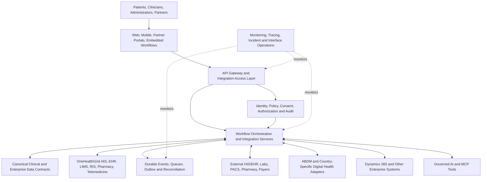

# OneHealthGrid

# Integration & Interoperability Whitepaper

**Connecting healthcare delivery, patient information, national digital health ecosystems, enterprise operations, and responsible AI**

| Document attribute | Value |
|---|---|
| Document ID | OHG-WP-INT-001 |
| Version | 1.0 |
| Publication date | 6 November 2026 |
| Classification | External technical whitepaper, architecture and product vision |
| Publisher | OneHealthGrid |
| Website | https://onehealthgrid.com/ |
| Primary geographic focus | India, with a multi-country architectural strategy |
| Intended audiences | Hospital executives, CIOs, CTOs, clinical informaticists, health-system architects, public-health authorities, procurement teams, integration partners, regulators, and technical implementers |
| Status | Reference architecture and integration strategy. **Not** an attestation that all described connectors are released, deployed, certified, or approved. |

> **Publication and capability disclosure.** This whitepaper describes the OneHealthGrid integration vision, proposed target architecture, design principles, implementation methodology, and example integration contracts. It is not a declaration of current production availability for every capability, external product, module, API, or country-specific adapter discussed. Project-specific deployment scopes, certification status, connector availability, contractual commitments, and technical conformance must be verified independently before procurement or deployment. The examples are illustrative, not live endpoint specifications.

---

## Executive summary

Healthcare delivery depends on information moving securely and accurately among people, systems, organizations, and jurisdictions. Yet many healthcare institutions still operate fragmented digital environments. Registration and identity data may reside in one system, encounters and clinical notes in another, diagnostics in a laboratory or radiology platform, pharmacy inventories in an ERP, payments in a billing application, and public-health reporting in external registries. Each disconnected system creates another opportunity for reconciliation effort, incomplete clinical context, delayed services, administrative waste, and unsafe or unauthorized disclosure.

**OneHealthGrid** envisions an integrated healthcare technology environment that unifies hospital information management, electronic health records, longitudinal care, diagnostics, pharmacy, telemedicine, financial operations, public-health interoperability, analytics, and governed AI-enabled workflows. Integration is not treated as an optional afterthought. It is a foundational architectural capability that must be designed into identity, data models, workflow execution, observability, security, and operational governance from the beginning.

The proposed architecture uses **standards-first, API-first, event-capable, privacy-by-design, and tenant-aware** principles. HL7 FHIR provides a central vocabulary and exchange model for many clinical interoperability use cases. ABDM-specific interoperability profiles and consent exchange workflows are addressed through country-specific adapters in India. HL7 v2, CDA, DICOM, DICOMweb, pharmacy interfaces, payment and insurer APIs, and proprietary hospital interfaces are supported as integration patterns where they remain operationally necessary. Enterprise integration includes a dedicated capability for Microsoft Dynamics 365 Finance and other finance, supply-chain, workforce, and reporting systems. AI and Model Context Protocol (MCP) are addressed through constrained, audited tool access rather than unconstrained access to protected clinical records.

This whitepaper presents the design rationale, ecosystem map, architectural layers, interface methods, canonical data strategy, identity and consent model, security and privacy posture, operational integration model, implementation approach, testing methodology, and phased roadmap. It also defines the difference between a standards-aligned design and a verified production integration: interoperability claims should be supported by test evidence, documented partner dependencies, and the certifications or approvals applicable to the deployment context.

### Strategic outcomes

OneHealthGrid's integration strategy is intended to enable a **more complete clinical context** at the point of care, reduce avoidable duplicate data entry, enable **consented health-information exchange**, streamline diagnostics and pharmacy workflows, connect clinical transactions with financial and supply-chain systems, support accountable public-health reporting, and permit governed innovation without weakening patient privacy. These outcomes are design goals and must be measured at each implementation site rather than assumed.

---

## 1. Why healthcare interoperability matters

### 1.1 The fragmentation problem

A modern care journey can traverse outpatient registration, triage, consultation, laboratory testing, diagnostic imaging, medication dispensing, inpatient admission, surgery, billing, claims, discharge, and follow-up. If each activity resides in an isolated application, patients and providers must repeat information, reconcile identities, manually transport documents, and interpret potentially inconsistent records. Integration programs should therefore be evaluated through care continuity, information quality, clinical safety, workflow resilience, and organizational efficiency, not merely the number of available APIs.

### 1.2 Four levels of interoperability

**Foundational interoperability** concerns whether one system can technically transmit information to another using an agreed transport, authentication model, and message envelope. A successfully delivered HTTP response is a foundational result, but it does not establish that the receiving system understands or acts on the data correctly.

**Structural interoperability** concerns the agreed shape of exchanged data. A standardized FHIR Observation, HL7 v2 ORU message, or DICOM study supports consistent parsing and validation. However, it does not by itself ensure consistent clinical meaning.

**Semantic interoperability** concerns terminology, codes, units, patient context, provenance, and clinical interpretation. For example, a result must preserve the measurement, analyte, unit, reference range where relevant, method if important, specimen, observation status, and relationship to the correct order and encounter. Terminology mappings must be reviewed and versioned.

**Organizational interoperability** concerns authority, contractual obligations, consent, governance, operating procedures, incident response, accountability, and trust among participating institutions. Secure interoperability requires operational alignment as well as technical connectivity.

### 1.3 Principles

1. **Clinical safety first.** Messages with missing identity, ambiguous units, unsafe terminology mappings, or contradictory state must be quarantined or rejected according to their clinical impact. They must not be silently converted into apparently valid records.
2. **Open standards where suitable.** Prefer well-maintained profiles, terminology systems, and documented APIs. Use proprietary adapters only where necessary, and isolate them from the canonical domain model.
3. **Consent and lawful authority are transaction-specific.** An authenticated system is not automatically authorized to exchange any patient's health information. Purpose, role, facility, patient context, authorization, and legal basis must be evaluated.
4. **Country-aware, tenant-safe operation.** Country, customer tenancy, facility, and patient identity boundaries remain distinct. External identifiers are scoped to their issuing systems.
5. **Resilience by design.** Expect outages, replays, duplicate notifications, partial completion, and delayed callbacks. Use idempotency, durable messaging, reconciliation, and transparent failure reporting.
6. **Observability without exposure.** Measure integration health and retain audit evidence while minimizing personal health information in logs, traces, queues, and support tooling.
7. **Verifiable claims.** A capability is not described as certified or production-ready until its conformance, security, legal, and operational acceptance evidence has been completed.

---

## 2. OneHealthGrid platform and ecosystem scope

### 2.1 Platform domains

The OneHealthGrid target ecosystem comprises patient and identity management, patient-facing and clinician-facing applications, hospital information system (HIS) workflows, electronic health records (EHR), personal health record (PHR) experiences, laboratory information management (LIMS), radiology information system (RIS) and picture archiving and communication system (PACS) interoperability, pharmacy and medication workflows, telemedicine, public-health programs, integration and API services, analytics and business intelligence, AI-ready workflows, and enterprise finance integrations.

These domains need not be deployed as a single monolith. Integration architecture should support modular product boundaries, facility-level operating models, and external systems that remain the system of record for a function. Deployment-specific designs must clearly identify which system owns each data category and workflow transition.

### 2.2 Stakeholders and external counterparties

**Care delivery organizations** include hospitals, health systems, specialty centres, outpatient clinics, primary healthcare centres, diagnostic providers, pharmacies, and home-care organizations. They may use OneHealthGrid as a primary platform, an integration layer, or a participating application alongside incumbent software.

**Patients and caregivers** interact with appointments, consent, clinical documents, communications, teleconsultations, and records made available to them under applicable authorization and policy. Patient-facing experiences must not automatically expose every internally stored record or third-party artifact.

**National and regional health networks** include India's Ayushman Bharat Digital Mission (ABDM), other country-specific health information exchanges, provider and facility registries, and public-health reporting services. Integration depends on program eligibility, participation requirements, supported API versions, consent architecture, and applicable approvals.

**Enterprise counterparties** include finance and supply chain platforms, Microsoft Dynamics 365, insurers and third-party administrators, payment systems, identity providers, communication services, data platforms, and approved AI service providers. Data sharing must be purpose-limited and governed by explicit contracts.

### 2.3 Integration categories

| Category | Representative systems | Typical data and process | Principal concerns |
|---|---|---|---|
| National digital health | ABDM, ABHA-related services, provider/facility registries, health exchange | Identification, discovery, linking, consent, exchange | Program rules, identity, consent, versioning |
| Clinical interoperability | External EHR/EMR, clinics, hospitals, HIEs | Encounters, diagnoses, medications, allergies, documents | FHIR profiles, terminology, provenance |
| Laboratory | LIMS, analyzers, reference laboratories | Orders, specimens, results, amendments | Specimen identity, units, critical results |
| Imaging | RIS, PACS, modalities, viewers | Imaging orders, worklists, studies, reports | DICOM identifiers, pixels, storage and access |
| Pharmacy | Pharmacy information systems, inventory, e-prescribing | Prescriptions, dispensing, stock and returns | Drug coding, substitutions, controlled workflows |
| Financial | Dynamics 365 Finance, ERP, billing, payments | Invoices, journals, receivables, procurement, stock valuation | Legal entity, posting controls, reconciliation |
| Payers | Insurers, TPAs, claims exchanges | Coverage, authorization, claims, remittance | Eligibility, coding, fraud controls |
| Public health | Surveillance, immunization, registries, program systems | Notifications, indicators, aggregates | Authority, minimization, jurisdiction |
| AI and analytics | Approved AI providers, MCP tools, data warehouses | Insights, summarization, decision support | Human oversight, data leakage, model governance |

---

## 3. Reference integration architecture

### 3.1 Architectural overview



*This is a logical architecture diagram, not a claim that these components have all been deployed or that a particular infrastructure product has been selected.*

### 3.2 Experience and access layer

External and internal applications should communicate through explicitly versioned interfaces, rather than bypassing service-level validation or directly manipulating data stores. Public, partner, facility, administration, patient, and clinical interfaces should have distinct access policies and rate controls. The access layer should support OpenAPI documentation for REST interfaces and published conformance artifacts for FHIR endpoints.

### 3.3 Identity, trust and policy layer

Authentication establishes the identity of a human or service actor. Authorization then evaluates tenant, facility, patient context, role, purpose, consent where required, permitted action, and the requested data. Sensitive access should be logged in a tamper-evident manner. Service credentials should represent an identifiable workload, have narrow privileges, be rotated, and be revoked independently of human identities.

### 3.4 Integration orchestration

Integration services route transactions, validate contracts, transform messages, coordinate workflows, manage retries, and correlate request-response or callback sequences. They should not become an uncontrolled master copy of every patient's longitudinal clinical record. Business rules that impact clinical decisions must have explicit ownership and versioned change control. Long-running transactions require compensating actions and reconciliation rather than an assumption that a distributed transaction can always be rolled back atomically.

### 3.5 Canonical models and terminology

A canonical model reduces the cost of integrating diverse external systems without imposing a false assumption that all domains are perfectly expressible in one schema. Use FHIR resources and profiles for appropriate clinical exchange, DICOM/DICOMweb for imaging, and domain-specific enterprise schemas for invoicing, procurement, and accounting. Maintain mapping specifications that identify source field, target field, datatype, cardinality, terminology, default policy, validation, ownership, and error treatment.

### 3.6 Events and operational delivery

Use durable asynchronous mechanisms for workloads that do not require immediate synchronous confirmation. An integration event should contain a unique event ID, event type, schema version, occurrence timestamp, source and destination context, tenant/facility scope, correlation ID, and minimal necessary payload or a protected reference. Use transactional outbox or equivalent controls where an application must commit both a state change and its event publication reliably.

### 3.7 Country and tenant boundaries

The global platform should have country-aware configurations rather than embedding India-specific identifiers into universal patient keys. Tenancy must be enforced end-to-end in API authorization, storage queries, queues, events, logs, backup workflows, caching, and analytics. Facility ownership is not synonymous with tenancy, and patient records must not be mixed merely because facilities operate on the same shared deployment. Any cross-tenant or cross-country exchange requires an explicit legal and technical basis.

---

## 4. Interoperability standards and technical protocols

### 4.1 HL7 FHIR

FHIR is a foundational resource-based healthcare interoperability standard. The OneHealthGrid architecture should support versioned FHIR interfaces and published profiles for use cases such as patient demographics, organizations, practitioners, encounters, appointments, conditions, allergies, observations, diagnostic reports, medication requests, medication dispensing, documents, consent, provenance, and audit events. Baseline compatibility must not be confused with conformance to a particular national implementation guide. Where ABDM requires a specified FHIR release and profile, that national contract governs that integration.

A proposed FHIR server or facade should disclose its `CapabilityStatement`, required security mechanisms, supported searches and operations, profile URLs, terminology bindings, resource permissions, and version behavior. Incoming resources should be validated against the relevant profiles and business constraints. FHIR `Bundle` types and transaction semantics must be selected deliberately; an arbitrary bundle is not automatically a valid clinical document.

### 4.2 HL7 v2 and CDA

Many existing hospitals, laboratories, and diagnostic providers rely on HL7 v2 messages for admissions, orders, results, and status updates. The target integration layer should accommodate facility-specific ADT, ORM, ORU and related message families where specified, including message acknowledgment, replay rules, sender/receiver identifiers, and control IDs. Mapping from HL7 v2 to FHIR should retain original source references and avoid dropping clinical qualifiers without review. CDA and other document formats may be supported through document-oriented connectors where required by a partner or national program.

### 4.3 DICOM and DICOMweb

Medical imaging requires specialized protocols and data structures. The integration design should support DICOM metadata and standard PACS interoperability, with DICOMweb transactions for search (QIDO-RS), retrieval (WADO-RS), and storage (STOW-RS) where supported. DICOM Study, Series and SOP Instance UIDs are essential identity references, but must still be validated against patient, accession, and order context. Pixel data access needs stricter authorization, storage lifecycle, bandwidth planning, and auditing than ordinary metadata browsing.

### 4.4 Terminology and coding

Interoperability requires more than moving JSON or XML. Use relevant clinical and administrative coding systems, potentially including SNOMED CT, LOINC, ICD, UCUM, local laboratory dictionaries, drug terminologies, and jurisdiction-specific payer and procedure codes, subject to licensing and local guidance. Terminology services should track system URI, version, code, display, validity, map provenance, and mapping confidence. A non-equivalent mapping must never be disguised as exact equivalence, especially for medication strengths, measurement units, and diagnosis categories.

### 4.5 REST, events, files and other patterns

Not all integrations should use the same protocol. RESTful APIs are suitable for interactive operations, secure events for durable notifications, batch files for large migrations or periodic exchange, and dedicated standards such as DICOM or HL7 v2 for installed environments. SFTP and signed file transfer can be supported as controlled legacy methods, with checksums, encryption, schema validation, and reconciliation. Avoid direct cross-system database writes because they bypass application business rules and create brittle coupling.

### 4.6 Profiles and conformance

Each integration must identify its binding standard, profile or implementation guide, supported version, transport, security model, test suite, endpoint catalogue, and known limitations. A generic statement such as “FHIR compatible” is insufficient for a procurement-grade acceptance test. Conformance is a property of a specific implementation and workflow, not an unlimited property of a brand.

---

## 5. ABDM and India digital health integration

### 5.1 Scope and architectural position

India's Ayushman Bharat Digital Mission aims to enable interoperable digital health infrastructure. Relevant ecosystem components and concepts include ABHA, Health Facility Registry (HFR), Health Professional Registry (HPR), health information provider (HIP) and health information user (HIU) workflows, Health Information Exchange and Consent Manager (HIE-CM) interactions, and ABDM-specified health data exchange. Additional ecosystems, including Unified Health Interface (UHI) and National Health Claims Exchange (NHCX), require separate use-case and program-specific analysis rather than being treated as one universal ABDM API.

OneHealthGrid should isolate ABDM-specific authentication, message routing, callbacks, profile validation, registration, and consent integration in a country adapter while keeping reusable clinical workflows within the core platform.

### 5.2 ABHA and identity linkage

ABHA-related workflows must follow the official APIs and current program requirements applicable to the integrator's role. Internal patient identity should remain distinct from ABHA identifiers. Linking must preserve proof of the appropriate identity and authorization workflow, source, time, and scope. Duplicate patients, shared phone numbers, incorrect demographic matches, and historic record associations require an exception process and human review when risk is material.

No clinical workflow should assume that every patient possesses ABHA or that inability to link ABHA justifies denying care. The correct behavior depends on the facility's legal obligations, product design, and deployment policies.

### 5.3 Facility and professional identifiers

HFR and HPR data should be handled as externally governed identifiers. Registry status, updates, verification, and participation eligibility must be refreshed according to official interfaces and governance rules. A hospital may operate several facilities with distinct registration and business rules; a facility is not inherently the same thing as a tenant, billing entity, or physical location.

### 5.4 HIP and HIU exchange

An implementation acting as a HIP must be able to identify permitted records, create or assemble conformant exchange artifacts, and respond through the prescribed consent-governed workflow. An implementation acting as a HIU must request and receive information only with the authorization and purpose permitted by the governing ecosystem and applicable law. Both roles require correct state transitions, signatures or encryption as prescribed, callback verification, and auditability.

**Illustrative exchange sequence:** A care organization identifies a clinically relevant need for external information. A properly authorized request is initiated through the applicable network workflow. The patient or authorized actor reviews and grants or denies consent where required. The network communicates the resulting authorization. The participating provider releases only permitted data, using the mandated format and encryption process. The receiving system validates the payload, matches patient and encounter context, records provenance, and exposes the result only to permitted users. Withdrawn or expired authorization must govern subsequent operations according to the ecosystem contract and law; it does not automatically imply retroactive erasure of lawfully retained clinical records.

### 5.5 Consent as an enforceable workflow

Consent is not merely a checkbox. It is a lifecycle: notice, purpose description, request, grant or denial, validity window, permitted information categories, authorized participants, revocation or expiry, evidence retention, and policy enforcement. ABDM consent artifacts and India DPDP obligations serve related but nonidentical purposes and must be mapped carefully. An ABDM exchange authorization should not be treated as universal authorization for unrelated analytics, marketing, AI model training, or unrestricted secondary use.

### 5.6 ABDM-specific mapping and validation

The implementation should validate resource profiles from the applicable ABDM FHIR Implementation Guide, including required document and record structures, terminology bindings, identifiers, timestamps, provenance, and bundle rules. Updates to the program's APIs or FHIR implementation guides must be subject to adapter versioning, regression testing, and release governance. The official sandbox and conformance pathway must be followed before making any implementation or certification claims.

### 5.7 UHI and claims ecosystems

UHI and claims-related integrations should be scoped as separate programs with their own actors, API versions, operational policies, and onboarding processes. A teleconsultation booking workflow, insurer authorization workflow, and clinical record exchange have distinct consent, payer, data, and business requirements. OneHealthGrid should not infer production eligibility from the availability of public API documentation.

### 5.8 Verification and limitation

The precise onboarding steps, permitted scopes, endpoints, cryptographic specifications, sandbox requirements, and approval rules must be validated against the **latest official ABDM/NHA materials at implementation time**. This whitepaper does not assert that OneHealthGrid currently holds ABDM approval, certification, or production integration status.

---

## 6. Patient, provider and clinical-record exchange

### 6.1 Patient identity resolution

The reference architecture separates platform patient IDs, tenant patient IDs, facility medical record numbers (MRNs), national identifiers, and external-system identifiers. Maintain an identity cross-reference service rather than overwriting an internal key with a network identifier. Probabilistic matching may assist with candidate identification, but clinically significant patient merges should follow controlled review, thresholds, reversibility, and audit procedures.

### 6.2 Encounter and clinical context

Every imported clinical event should be associated with the correct patient, source organization, facility, practitioner where relevant, encounter, effective time, recorded time, and provenance. External encounter identifiers must not be assumed globally unique. Timezone conversion must preserve original timestamps and timezone offsets where available.

### 6.3 Longitudinal records and documents

A longitudinal view should present relevant information across encounters without erasing data provenance or replacing source-system authority. External documents may be indexed as references, retained copies, or transformed structured records depending on contract, consent, and storage policy. Document ingestion should include malware scanning, content validation, duplicate detection, source attribution, confidentiality labels where applicable, and clinical review requirements.

### 6.4 Orders, results and amendments

Order-to-result integration should enforce identifiers, status transitions, and linkage between requested procedure and reported result. Preliminary, final, corrected, and canceled states must be distinguished. When a laboratory corrects a result, the correction should preserve the superseded value and audit history rather than silently rewrite clinical evidence.

### 6.5 Medication workflows

Medication integration should distinguish an order, authorization, dispense, administration, reconciliation statement, and inventory movement. A physician's prescription is not equivalent to a pharmacy dispense or a patient's medication adherence. Drug coding, dosage form, route, strength, schedule, quantity, substitution, and allergy alerts need careful mapping and clinical safety checks.

### 6.6 Referral and care coordination

Referrals should preserve originating facility, receiving service, referral reason, clinical summary, attachments, triage status, acceptance, appointment, and feedback loop. The receiving organization must have a lawful basis and appropriate authority for any clinical data transfer. Support partial integration when a partner can accept a referral but cannot send full structured progress updates.

---

## 7. Laboratory integrations

### 7.1 Typical transaction flow

The clinical system creates a laboratory request with patient, encounter, ordering practitioner, service codes, priority, clinical context, and specimen requirements. The LIMS acknowledges the request and manages specimen collection, accessioning, processing, quality checks, analysis, and result release. Results return to the clinical record with appropriate status, reference ranges, units, and alerts. A critical value may require an additional escalation workflow distinct from ordinary delivery.

### 7.2 Analyzer and reference-laboratory connectivity

LIMS may integrate with laboratory analyzers or external reference laboratories using vendor protocols, HL7 v2, ASTM-derived formats, file exchange, or APIs. The canonical clinical interface should not assume analyzer-specific formats are equivalent to validated final results. Reference-lab status and turnaround must be reconciled with local ordering and specimen records.

### 7.3 Safety controls

Mandatory controls include specimen and barcode identity, correct patient and order linkage, unit harmonization, abnormal/critical flag interpretation, instrument and laboratory provenance, result amendments, test cancellation, and duplicate transmission handling. When mappings are missing or clinically ambiguous, the receiving system should quarantine the item for qualified review.

---

## 8. Radiology, imaging and PACS interoperability

### 8.1 Workflow architecture

Radiology integration spans order placement, modality scheduling, accession number allocation, modality worklists, image capture, storage, interpretation, report finalization, and clinician review. OneHealthGrid's target architecture should interface with existing RIS/PACS infrastructure where it is the system of record rather than require imaging assets to be relocated without a justified deployment requirement.

### 8.2 DICOM interoperability

The integration should preserve DICOM Study Instance UID, Series Instance UID, SOP Instance UID, accession references, modality, study date/time, patient identity mapping, and de-identification status. DICOMweb QIDO-RS, WADO-RS and STOW-RS support modern search, retrieval and storage workflows where the participating systems implement them. Legacy DICOM association-based workflows may still be needed for modalities and on-premises installations.

### 8.3 Viewer access and data protection

An imaging viewer should receive time-limited, scope-limited access to authorized studies. Download, sharing, and export policies should vary by role, purpose, facility, and jurisdiction. De-identification of pixel data requires more than stripping identifiers from DICOM headers because burned-in annotations may contain personal information.

### 8.4 Report synchronization

Imaging reports may arrive as narrative text, structured reports, documents, or appropriate FHIR resources. The system should correlate the report with the correct order and imaging study, preserve preliminary/final/amended status, and display provenance clearly. Image availability and report finalization are separate workflow states.

---

## 9. Pharmacy, inventory and medication integration

Pharmacy systems connect clinical prescribing with stock, dispensing, purchase, replenishment, returns, lot and expiry tracking, and financial valuation. A safe interface should ensure that medication catalog synchronization does not silently replace a prescribed drug with a non-equivalent item. Separate clinical drug concepts from product SKUs, pack sizes, inventory units, tax classification, and procurement codes.

A dispensing event can update clinical medication records and inventory balances, but the two systems may process at different speeds. Use explicit transaction IDs, batch or lot references where required, reversal controls, reconciliation, and clear ownership of stock quantities. Offline workflows must queue transactions safely and provide conflict handling when connectivity returns. Patient-level medication data should not be sent to an ERP unless that specific field is necessary and authorized for the business purpose.

---

## 10. Telemedicine and patient engagement

Telemedicine integration connects scheduling, consultation authorization, identity verification, video or communication services, clinical documentation, electronic prescriptions where permitted, billing, and follow-up. Access to a meeting link is not equivalent to permission to view the patient's longitudinal record. Clinical notes and recording policies require explicit governance, especially for sensitive encounters.

Patient communications may use email, SMS, mobile notifications, and approved messaging vendors. Notification payloads should be minimized so that sensitive diagnoses and clinical results are not unnecessarily placed into general-purpose communication services. Delivery receipts should not be treated as proof of patient comprehension, identity verification, or clinical consent.

For India, implementation must be reviewed against applicable professional guidance and the legal constraints governing telemedicine and prescribing. For international deployments, each jurisdiction requires a separate professional, privacy, data-residency, and service-eligibility assessment.

---

## 11. Enterprise integration: Microsoft Dynamics 365 Finance

### 11.1 Integration philosophy

OneHealthGrid's integration architecture should provide a configurable connection between clinical or operational workflows and Microsoft Dynamics 365 Finance, while retaining a strong boundary between patient care records and enterprise financial systems. This is a **target integration capability**; the availability of a certified, prebuilt, or production-supported connector must be separately established.

Clinical systems typically own encounters, service delivery, clinical orders, and patient-care documentation. Finance systems typically own legal-entity ledgers, general ledger structures, tax rules, financial dimensions, customer/vendor master data, posting policy, financial close, and approved accounting transactions. The exact system-of-record boundary is a deployment decision formalized in a responsibility matrix.

### 11.2 Representative integration scenarios

| Integration scenario | Originating domain | Destination domain | Typical pattern | Key control |
|---|---|---|---|---|
| Patient service charge to receivable | HIS/billing | D365 Finance | Validated API or scheduled batch | Legal entity, tax, pricing and posting status |
| Payment settlement | Payment/billing | D365 Finance | Event plus reconciliation | Settlement reference and bank matching |
| Vendor master synchronization | Finance/procurement | Operational purchasing | API or batch | Ownership, approval and duplicate prevention |
| Purchase requisition or order | Procurement workflow | D365 Finance | API or asynchronous package | Approval and purchase-order state |
| Inventory accounting | Pharmacy/stores | Finance/Supply Chain | Aggregated events or batch | Item mappings, stock valuation, units |
| Cost-centre and financial dimensions | D365 Finance | Operational reporting | Reference-data synchronization | Effective date and legal entity |
| Expense or service accrual | Operational system | D365 Finance | Controlled journal interface | Authorized mapping and reconciliation |
| Financial reporting | D365 Finance | Analytics | Governed export/connector | Confidentiality and consistency |

### 11.3 Microsoft integration mechanisms

Microsoft documents several integration options for Dynamics 365 Finance and Operations applications. **OData data entities** are appropriate for supported entity-based operations, **Data Management Framework package APIs** support asynchronous package transfer, **business events and data events** support event-driven scenarios subject to platform prerequisites, and **custom services** address specific operations requiring tailored business logic. Microsoft also provides Power Platform and connector approaches for applicable cloud scenarios. The correct mechanism depends on transaction volume, latency, business semantics, deployment mode, licensing, supported entities, and the Microsoft environment's features. For example, some Power Platform integration capabilities are not available to on-premises environments.

### 11.4 Configuration model

A proposed OneHealthGrid D365 connector should have per-tenant and, where necessary, per-legal-entity configuration for Microsoft Entra application identity, environment URL, authorized client credentials or certificate, company mapping, entity mapping, ledger dimensions, tax code references, currency, accounting dates, synchronization schedules, event subscriptions, retry policies, and error-notification recipients. Secrets must be stored in a dedicated secret management mechanism, never exposed in UI responses or ordinary logs.

### 11.5 Posting discipline

Clinical activities must not be considered financially posted solely because an outbound API call was made. Each transaction needs a lifecycle such as **Prepared → Validated → Submitted → Accepted/Processing → Posted or Rejected → Reconciled**, with states adapted to the actual D365 mechanism. A returned transport success is not necessarily proof that financial posting has completed. Reconciliation must compare amounts, currency, tax, dimensions, identifiers, and post status against the finance system of record.

### 11.6 Example charge-to-finance narrative

A clinician completes a billable service. OneHealthGrid's billing engine validates the approved charge, payer responsibility, and local accounting treatment. The integration service maps the transaction to the correct D365 legal entity and financial dimensions, assigns an idempotency reference, and submits it through the selected integration interface. The finance system processes the transaction and returns a reference or status. The integration service periodically reconciles the operational charge with the authoritative financial posting, escalating mismatches. If the original charge is canceled, a documented reversal or credit process is used rather than deleting the transaction silently.

### 11.7 Finance and clinical data separation

Financial integrations should transmit only the information needed for accounting or payment. Clinical diagnoses, consultation notes, and sensitive test results should not be bundled into ERP payloads unless a specific lawful and contractually justified business process requires them. Where billing identifiers reveal sensitive service types, access and retention controls should still be applied.

---

## 12. Payers, claims and payment ecosystems

Payer integration can encompass eligibility checks, pre-authorization, claim generation, attachment exchange, adjudication status, denial management, payment advice, and reconciliation. Different insurers and national exchanges use different identifiers, coding rules, document contracts, and authorization processes. OneHealthGrid should maintain payer-specific adapters and policy mappings rather than treating all claims as a generic invoice exchange.

Financial reconciliation should distinguish estimated liability, submitted amount, approved amount, disallowed amount, patient copayment, received amount, and outstanding balance. Claims and payment identifiers should remain immutable and traceable. Any automated decision affecting patient or provider access to benefits must have an appeal or human review process as required by the applicable program.

---

## 13. Government and public-health interoperability

Public-health integrations may support notifiable disease reporting, immunization reporting, maternal and child health programs, population-level indicators, program monitoring, facility performance, and referral coordination. The architecture must preserve the distinction between **clinical care** and **public-health authority**, which may have different lawful bases, reporting schedules, pseudonymization requirements, and permitted recipients.

A government deployment may require integration with existing district, state, or national systems and accommodate low-connectivity environments, multilingual workflows, and federated provider networks. The integration approach should support signed or authenticated submissions, acceptance acknowledgments, error correction, and aggregate reporting where person-level details are unnecessary. No assumption should be made that a general hospital software implementation automatically has authorization to connect to every government registry or public-health endpoint.

---

## 14. API platform and developer ecosystem

### 14.1 API design standards

A production API program should publish versioned contracts using OpenAPI for ordinary REST APIs and FHIR conformance resources or implementation guides for applicable clinical endpoints. API paths, resource representations, error envelopes, HTTP semantics, pagination, filtering, patch/update rules, and time formats should be stable and documented. Breaking changes require versioning and migration notices.

### 14.2 Authentication and authorization

Support appropriate identity protocols such as OAuth 2.0 and OpenID Connect, with scoped access tokens, audience validation, endpoint authorization, and service-to-service credentials. Where applicable, SMART on FHIR patterns may be evaluated for third-party clinical apps. Require token lifetime controls, key rotation, audit logs, least privilege, and security testing. Mutual TLS or private networking can be required for highly sensitive partner integrations.

### 14.3 API lifecycle management

Maintain a developer onboarding process covering partner registration, data-processing agreement, sandbox access, credentials, scopes, callback verification, API documentation, contract tests, quotas, monitoring, and deprecation. Sandbox fixtures should use synthetic data by default. Production access should require an explicit onboarding and risk review, not simply the possession of a test API key.

### 14.4 Illustrative API contract

The following example illustrates a design pattern, not an existing OneHealthGrid production endpoint or committed contract:

```http
POST /api/v1/integration-jobs HTTP/1.1
Authorization: Bearer <access-token>
Content-Type: application/json
Idempotency-Key: <unique-operation-id>
X-Correlation-ID: <correlation-id>

{
  "type": "laboratory-result-import",
  "sourceSystem": "partner-lims-example",
  "facilityReference": "facility-local-reference",
  "payloadReference": "opaque-secure-object-reference",
  "schemaVersion": "1.0"
}
```

A suitable response may acknowledge durable acceptance while processing continues asynchronously. The response should expose a status resource or correlation reference, not promise that clinical import is complete until validation and persistence succeed.

### 14.5 Webhooks

Webhook subscribers should validate message authenticity, subscription identity, event freshness, request IDs, and replay handling. Callback URLs should be restricted to approved HTTPS destinations, with protections against server-side request forgery, private-network targeting, and destination manipulation. Webhook retries should be bounded and observable, with dead-letter handling and a replay procedure.

---

## 15. AI, analytics and MCP integration

### 15.1 Role of AI

AI-enabled integration may support document summarization, coding assistance, workflow triage, operational analysis, conversational retrieval, or structured extraction. These are prospective use cases, not a representation that clinical diagnosis or treatment decisions can be delegated to an unvalidated model. The appropriate clinical safety class, testing, human supervision, and regulatory review depend on the function and jurisdiction.

### 15.2 Model Context Protocol

MCP can provide a structured mechanism for connecting approved AI clients to narrowly scoped tools and data resources. For OneHealthGrid, an MCP server should be treated as a **security-sensitive integration surface**, not a shortcut around the standard API gateway or authorization system. Each tool call requires authenticated principal context, patient/facility scoping, purpose validation, data minimization, consent where required, and audit evidence.

Read-only search, approved retrieval, and administrative operations should be exposed separately. Write operations such as creating an order, modifying a medication record, sharing clinical documents, or posting finance transactions require stronger controls, explicit confirmations, and sometimes human approval. Prompts and tool outputs are untrusted input; protections must address prompt injection, cross-tenant data access, excessive agency, leakage into model providers, and unsafe execution chains.

### 15.3 Provider governance and data use

External AI service providers must be evaluated for data residency, contractual processing rights, retention, model training policies, auditability, security controls, breach notification, and subprocessors. Protected health information should not be supplied to third-party models unless the applicable legal, contractual, and technical conditions are satisfied. De-identification and pseudonymization are risk-reduction mechanisms, not guarantees that data cannot be re-identified.

### 15.4 Analytics interoperability

Analytical pipelines should distinguish clinical operational reporting, patient-care decision support, institutional quality measurement, financial analytics, and secondary research. Each has different purpose and permission boundaries. Data quality reports should disclose missingness, coding mismatches, source freshness, and transformation assumptions. Where possible, use aggregated or minimized datasets and preserve lineage from source to dashboard.

---

## 16. Security, privacy and consent governance

### 16.1 Security-by-design principles

Protect information in transit using current secure transport configurations and protect stored sensitive information using appropriate encryption, key management, least privilege, and operational separation of duties. Integrations should be threat-modeled for credential theft, forged callbacks, replay attacks, patient misidentification, privilege escalation, tenant isolation failure, unsafe file uploads, malicious messages, and third-party compromise.

### 16.2 Access-control model

A robust policy decision should consider: **Who** is requesting access; **which organization, tenant, and facility** they represent; **which patient and encounter** are involved; **what action and information category** are requested; **for what purpose**; **which consent or other legal basis** applies; and **which contextual restrictions** are in force. Emergency or break-glass access, if offered, must be exceptional, justified, time-bounded, heavily audited, and subject to retrospective review.

### 16.3 India DPDP legislation

The **Digital Personal Data Protection Act, 2023** and **Digital Personal Data Protection Rules, 2025** provide an important privacy framework for relevant processing in India. The Rules were notified in November 2025, with staggered commencement dates; legal obligations must be evaluated against the provisions actually in force on the deployment date, relevant rules and corrigenda, and the operating entity's role. Data fiduciary and data processor responsibilities must be distinguished contractually and technically. Health-specific contractual, professional, and sectoral obligations may apply alongside DPDP requirements.

The platform should support understandable notices, purpose-specific processing controls, consent management where applicable, request handling, appropriate security safeguards, record retention and deletion policies, breach handling, and evidence for compliance reviews. This whitepaper is a technical description and not a legal opinion or a representation of achieved statutory compliance.

### 16.4 International governance

For multi-country deployments, the platform should employ a jurisdictional policy framework covering hosting and transfer restrictions, data subject rights, medical record retention, professional access, research uses, consent, audit, and breach reporting. GDPR, HIPAA, and other regimes may apply to particular organizations and geographies, but no deployment should be called compliant merely because the product architecture includes encryption or consent features. Country-specific assessments and contracts remain mandatory.

### 16.5 Logging and audit evidence

Integration audits should record actor, authorization decision, purpose, source, destination, patient and facility references where appropriate, event type, consent reference, status, timestamps, and tamper-evident correlation identifiers. Audit records should be retained securely under a defined schedule. Avoid storing access tokens, full request bodies, raw clinical notes, or passwords in standard application logs. Support bounded access for investigations and privileged administrator review.

### 16.6 Third-party risk

Every external integration adds dependencies and attack surface. Partner onboarding should evaluate vendor security posture, incident response capability, patching, data processing terms, data location, vulnerability management, subcontractors, and exit obligations. API credentials and certificates should be revocable per partner, and partner suspension should not require a platform-wide outage.

---

## 17. Reliability, observability and reconciliation

### 17.1 Delivery guarantees

Distributed integration must assume that messages may arrive late, repeatedly, out of order, or not at all. Design for **at-least-once delivery with idempotent handling** where appropriate, instead of promising universal exactly-once delivery. Use stable business keys and operation IDs, bounded retries with backoff, replay windows, dead-letter handling, and manual exception queues.

### 17.2 Integration state management

Track each operation through a clear lifecycle such as **Created → Validated → Queued → Submitted → Acknowledged → Applied → Reconciled**, with terminal error, retry, cancellation, or exception states as appropriate. Distinguish transport acknowledgment from business acceptance and from completion in the destination system. Provide operators with traceable transaction histories without exposing unnecessary patient information.

### 17.3 Service-level indicators

Suggested measures include interface availability, transaction completion rate, acknowledgment latency, event backlog age, retry count, dead-letter volume, reconciliation variance, mapping failures, consent-related denials, duplicate detection rate, and security incident counts. Clinical alerting must prioritize safety-critical integration failures over routine administrative delays. Actual SLO thresholds should be determined contractually and validated through load testing.

### 17.4 Outage and recovery scenarios

Where a remote system is unavailable, queue safe work only when its business meaning remains valid later. Some clinical transactions expire or require revalidation after a delay. Recovery procedures should reconcile source and destination state rather than replay all messages blindly. Offline or intermittent facilities need explicit sync windows, conflict policies, local audit records, and limits on actions requiring current external authorization.

### 17.5 Disaster recovery

Recovery design should document RTO/RPO targets, backup scope, encryption key dependencies, region and country constraints, message queue persistence, replay and deduplication after restore, partner endpoint failover, and clinical downtime procedures. Recovery testing must include partial-state corruption and mismatched external acknowledgments, not only database restoration.

---

## 18. Data migration and coexistence

Existing institutions rarely replace every application simultaneously. OneHealthGrid's integration strategy should therefore support coexistence, staged migration, dual operation where justified, and controlled retirement of legacy interfaces. Migration plans should inventory source systems, data owners, record counts, coding systems, document repositories, identity-quality issues, historical corrections, retention obligations, and the legal basis for data transfer.

A representative migration sequence includes **discovery, profiling, mapping, cleaning, transformation, dry run, validation, cutover planning, cutover, post-cutover reconciliation, stabilization, and legacy decommissioning**. Clinical migration acceptance should involve qualified clinical stakeholders who can verify meaning, not just record counts. Historical records should retain original source provenance. Data migration must not be used as a reason to bypass current access restrictions or destroy required audit evidence.

---

## 19. Integration delivery methodology

### 19.1 Discovery and requirements

For each interface, define business objective, responsible organization, system of record, stakeholder roles, inbound and outbound data, transaction volumes, peak loads, business hours, consent/legal basis, required standards, recovery needs, and downstream dependencies. Produce a signed interface inventory and clinical safety assessment where applicable.

### 19.2 Contract and architecture design

Deliver interface control documents (ICDs), sequence diagrams, field mappings, profile references, authentication and authorization designs, sample payloads, status mappings, error taxonomy, replay policies, data retention requirements, and operational handoff rules. Define clear roles for source system, target system, integration service, clinical owner, privacy lead, and support team.

### 19.3 Build and environment separation

Use isolated development, test, sandbox, and production credentials. Never use production patient information in nonproduction environments without an approved legal and security basis. Infrastructure configuration, secrets, API specifications, and schema mappings should be version-controlled or managed through controlled configuration systems.

### 19.4 Verification and acceptance

Test nominal workflows and negative cases: invalid token, expired consent, missing patient, mismatched identifiers, duplicate events, unexpected terminology, delayed callbacks, partial outage, oversized attachments, transaction reversal, timezones, queue failure, and unauthorized cross-tenant access. Include clinically relevant content testing, penetration testing, operational runbooks, and performance measurement.

### 19.5 Cutover and hypercare

Deployment should include endpoint and certificate verification, rollback plans, communication channels, on-call coverage, reconciliation checkpoints, acceptance criteria, and incident escalation. During hypercare, monitor exception queues, patient identity errors, incomplete transactions, and partner-side failure trends. Declare operational acceptance only when the agreed evidence and sign-offs exist.

---

## 20. Reference implementation scenarios

### Scenario A: Patient information exchange across hospitals

A patient attends a new hospital and authorizes access to relevant external health records through an applicable health network. The receiving application verifies the request context and authorized scope, retrieves permitted exchange artifacts, validates their profiles and integrity, reconciles patient identity, records provenance, and makes the information available to authorized clinicians. The result is an improved potential view of clinical history without implying that every external record is automatically correct or complete. The workflow must handle consent denial, timeout, missing records, and contradictory clinical information safely.

### Scenario B: Order-to-result laboratory workflow

A consultation generates laboratory requests with traceable identifiers. The partner LIMS receives the orders, confirms accession and specimen status, and later releases validated results. OneHealthGrid validates patient/order linkage, coded analytes, units, values, status, and provenance. A critical result can trigger a controlled clinical notification, while corrected reports retain a history of the prior result and the correction reason.

### Scenario C: Imaging lifecycle across RIS and PACS

The ordering application sends a radiology request. A RIS assigns accession and scheduling information and coordinates acquisition. The modality or PACS retains the images, while OneHealthGrid records study references and reporting status. Authorized clinicians retrieve images through an approved viewing flow. Changes to patient identity, canceled examinations, amended reports, and migrated studies must be reconciled.

### Scenario D: Clinical billing to Dynamics 365 Finance

OneHealthGrid operational billing generates a verified charge or settlement record. An enterprise adapter maps that transaction to the destination legal entity, customer reference, tax treatment, currency, and financial dimensions. It submits through the selected Microsoft-supported integration mechanism and monitors subsequent processing. Reconciliation confirms the final posting, while rejection routes the item for correction without losing the original business transaction.

### Scenario E: Government health program reporting

A health program requires standardized activity reports. OneHealthGrid extracts eligible information under the applicable program authority, validates facility identifiers and reporting periods, applies approved minimization or aggregation, and submits through the prescribed interface. Submission acknowledgments and downstream rejections are tracked; corrected submissions are linked to the originals, and public-health reports do not automatically grant broad access to underlying patient records.

### Scenario F: AI-assisted clinical document summarization

An authorized clinician requests a summary of selected documents for a patient encounter. The workflow checks identity, facility, purpose, access rights, and approved AI-processing policy. The AI tool receives only the approved minimum context through a governed connector, produces an attributed draft, and requires clinician review before incorporation into the medical record. The workflow retains provenance and model metadata while prohibiting an unreviewed draft from becoming an authoritative diagnosis.

---

## 21. Integration governance and responsibilities

An effective integration program requires explicit governance. The **clinical owner** approves clinical semantics and safety requirements. The **system owner** defines authoritative data and change management. The **integration architect** owns interface design and dependency analysis. The **information security and privacy functions** review trust, authorization, processing and retention. The **partner owner** coordinates third-party contracts and incidents. The **operations team** owns monitoring, support, reconciliation, and runbooks. The **change advisory authority** approves controlled production changes and rollback conditions.

Every interface should have an owner, a support contact, documented SLOs, versioned specifications, credentials inventory, risk classification, test evidence, and decommissioning plan. Changes to terminology, API shape, consent logic, financial mapping, or clinical workflow should be assessed for impact and propagated through regression tests before release.

---

## 22. Phased adoption roadmap

The following roadmap is a **proposed sequencing model**, not a representation of completed delivery milestones.

| Phase | Architectural priority | Exit evidence |
|---|---|---|
| 0: Foundation and governance | Tenant/country isolation, identity, API conventions, consent framework, data catalog, interface inventory | Approved architecture, risk register, policy decisions |
| 1: Core clinical interoperability | Patient identity cross-reference, FHIR baseline, HIS/EHR exchange, audit and terminology service | Profile conformance tests, clinical workflow acceptance |
| 2: Diagnostic and pharmacy interfaces | LIMS, RIS/PACS, medication and inventory adapters, exception workflows | End-to-end interface tests, corrections/reconciliation evidence |
| 3: India ecosystem integrations | ABDM actor-specific flows, HFR/HPR and ABHA workflows, consent exchange, applicable FHIR profiles | Current sandbox/approval evidence and security review |
| 4: Enterprise and payer connectivity | D365 Finance, ERP mappings, payments, payer/claims integration | Accounting reconciliation, payer workflow acceptance |
| 5: Public health, analytics and AI | Governed program reporting, data products, MCP tool gateways, human-reviewed AI | Privacy assessments, AI safety tests, operational metrics |
| 6: Multi-country expansion | Jurisdictional policy packs, local terminology and adapters, deployment controls | Country-specific legal, clinical and interoperability sign-offs |

Phases may overlap if dependencies, contractual scope, safety assessment, and implementation capacity permit. Do not start a dependent interface without a stable authorization model, known system of record, mapped identifiers, and defined failure behavior.

---

## 23. Benefits and measurement framework

Rather than promise unsupported percentage improvements, OneHealthGrid proposes measurement at the deployment level. Potential indicators include reduced duplicate demographic entry, fewer unmatched lab results, faster availability of diagnostic reports, improved referral closure, reduced days spent reconciling operational charges to ERP postings, fewer interface support tickets, increased consent-compliant exchange completion, improved time-to-detect incidents, and reduced manual rework. Baselines, measurement windows, exclusions, and independent review should be established before claiming success.

For healthcare leaders, integration success should be evaluated across **clinical safety, operational efficiency, financial controls, patient experience, compliance, and resilience**. A platform may deliver a large number of transactions yet still be unsuccessful if records are matched incorrectly, critical results are delayed, or audit trails are incomplete.

---

## 24. Risks, dependencies and open design decisions

The full integration program depends on external systems, approved partner access, current API versions, local terminology licensing, deployment-specific governance, and tested infrastructure. Key decisions that must be closed during product specification and implementation include:

| Decision area | Required resolution | Why it matters |
|---|---|---|
| Current product availability | Classify each connector as planned, in development, tested, production-supported, or independently certified | Prevents overstatement and procurement confusion |
| FHIR version and implementation guides | Select supported baseline and jurisdiction-specific profile releases | Prevents incompatible exchange payloads |
| Patient identity and cross-reference | Define matching, merge, unlink and dispute procedures | Mitigates clinical safety and privacy risk |
| Consent and lawful processing | Map exact actors, purposes, consent artifacts and rights workflows | Ensures authorization is enforceable |
| Data stewardship | Define source-of-truth ownership for every domain | Prevents conflicting edits and reconciliation failure |
| Infrastructure and residency | Approve shared/regional deployment and data placement constraints | Supports contractual and national requirements |
| Dynamics 365 mappings | Identify legal entity, modules, supported API mode and posting rules | Ensures financial accuracy |
| Imaging storage policy | Decide link/reference versus managed image copies and retention | Controls cost, performance and privacy |
| Public health integrations | Verify program authority, submission formats and onboarding | Avoids unauthorized registry access |
| AI/MCP governance | Approve tool scopes, human review, model providers, retention and prompt protections | Limits clinical and privacy exposure |
| SLA and recovery | Set criticality-specific RTO/RPO, SLO and escalation | Makes operations testable |

These decisions must be recorded in the authoritative OneHealthGrid specification repository, **`routeget/DigitalHealth`**, before corresponding product capabilities are declared development-ready or released. The whitepaper itself is not a substitute for detailed functional, API, security, deployment, test, and operational specifications.

---

## 25. Conclusion

Healthcare interoperability is meaningful only when trusted information reaches the right person or system, in the right form, at the right time, for an authorized purpose. The OneHealthGrid integration vision therefore goes beyond a catalogue of connectors. It describes a governed architectural foundation that brings together clinical workflows, national health infrastructure, diagnostic networks, medicine supply, enterprise financial controls, public-health programs, and carefully constrained AI systems.

By designing around open standards, authoritative identifiers, clinical provenance, patient and organizational rights, security-by-design, durable workflows, and measurable outcomes, OneHealthGrid aims to reduce integration fragmentation without compromising the boundaries that make healthcare data trustworthy. As the platform evolves, the ultimate evidence of this strategy must be demonstrated through interoperable implementations, documented conformance, tested production operations, and transparent communication about what is available.

**OneHealthGrid: Connected Healthcare. Trusted Interoperability. Better Decisions.**

---

# Appendix A. Standards and protocol selection matrix

| Domain | Candidate standard or approach | Typical use | Notes |
|---|---|---|---|
| Clinical resource exchange | HL7 FHIR | Structured EHR sharing, search, documents | Use named versions and implementation guides |
| National India exchange | ABDM-specified APIs and FHIR profiles | Consented health-data exchange and ecosystem workflows | Follow current official rules and onboarding |
| Legacy clinical messaging | HL7 v2 | ADT, orders, laboratory results | Partner-specific conformance and acknowledgment |
| Clinical document exchange | CDA or FHIR document bundles | Discharge summaries and records | Validate document composition and provenance |
| Imaging | DICOM/DICOMweb | Search, retrieval, store, imaging metadata | Separate metadata and pixel access controls |
| Terminology | SNOMED CT, LOINC, ICD, UCUM, local codes | Semantic alignment | Licensing and version governance required |
| Enterprise master data | OData/REST/API, batch | Vendors, customers, dimensions, items | Respect source-system business rules |
| D365 large-volume integration | Data Management Framework package API | Imports, exports and bulk sync | Validate Microsoft deployment-specific support |
| D365 event integration | Business events, data events | Finance process notifications | Feature prerequisites may apply |
| Partner notifications | Signed webhooks, event queues | Asynchronous state changes | Replay prevention and bounded retry |
| Secure file exchange | SFTP or approved object exchange | Legacy batch import/export | Encryption, checksum, reconciliation |
| AI tool interoperability | MCP with controlled tool gateway | Scoped AI-assisted tasks | Never bypass healthcare authorization |

# Appendix B. Canonical integration envelope (illustrative)

This envelope is a **design example**, not an approved API schema. Every implementation must define its own formal schema, data classification, signature policy, retry behavior, and FHIR or business payload contract.

```json
{
  "eventId": "evt-example-0001",
  "eventType": "diagnostic-report.finalized",
  "schemaVersion": "1.0",
  "occurredAt": "2026-11-06T08:00:00Z",
  "sourceSystem": "laboratory-system-a",
  "tenantReference": "tenant-scope-example",
  "facilityReference": "facility-example",
  "correlationId": "corr-example-0001",
  "resourceReference": {
    "type": "DiagnosticReport",
    "id": "example-report-reference"
  },
  "securityClassification": "restricted-health",
  "payloadMode": "secure-reference"
}
```

**Interpretation:** `tenantReference` and `facilityReference` are illustrative scoping references and must not expose cross-tenant identifiers improperly. The resource reference must be resolved only through an authenticated, authorized API that performs full patient and facility access checks. An event may report that a final result exists without including its clinical contents.

# Appendix C. Interface control document template

A production interface specification should contain the following sections, each elaborated for the actual partner and workflow:

1. **Business purpose and operational owner.** Describe the care or administrative process served, participating organizations, decision rights, clinical impact, and support ownership.
2. **Systems and authority.** Identify the source, destination, canonical model, authoritative records, facility and tenant scope, and supported versions.
3. **Security and privacy.** Document authentication, authorization, patient context, lawful processing basis, consent references, encryption, retention, and audit evidence.
4. **Contracts and mapping.** Provide endpoint definitions, payloads, fields, codes, profile URLs, units, error conditions, update semantics, and sample transactions.
5. **Delivery guarantees.** Define acknowledgment, retries, ordering, idempotency, deduplication, reconciliation, exception queues, and replay.
6. **Operations.** Define SLOs, monitoring, alert routing, incident response, runbooks, downtime modes, rollback, recovery, and partner contacts.
7. **Testing and approvals.** Include normal and failure test cases, security tests, performance results, clinical validation, sign-offs, and release history.

# Appendix D. Suggested integration acceptance checklist

- [ ] The data owner, business owner, and clinical safety owner are identified and approve the workflow where applicable.
- [ ] Both source and target validate the contract, identifiers, terminology, timestamps, lifecycle states, and error categories.
- [ ] Tenant, facility, patient, role, purpose, and consent boundaries have positive and negative authorization tests.
- [ ] Credentials, certificates, callback validation, transport protection, and secret rotation have been tested.
- [ ] Duplicate, delayed, reordered, rejected, expired, interrupted, and replayed messages have documented outcomes.
- [ ] Monitoring, dashboards, alert thresholds, trace IDs, reconciliation, replay, and clinical escalation procedures are operational.
- [ ] Relevant regulatory, program, security, contractual, clinical, and financial sign-offs are recorded.
- [ ] The implementation report identifies actual deployed versions, unresolved limitations, and evidence for any conformance or certification claim.

# Appendix E. Glossary

| Term | Meaning |
|---|---|
| ABDM | Ayushman Bharat Digital Mission |
| ABHA | Ayushman Bharat Health Account |
| API | Application Programming Interface |
| CDA | Clinical Document Architecture |
| DICOM | Digital Imaging and Communications in Medicine |
| DICOMweb | DICOM's web services defined in PS3.18 |
| DPDP | India's Digital Personal Data Protection legal framework |
| EHR/EMR | Electronic Health Record / Electronic Medical Record |
| ERP | Enterprise Resource Planning |
| FHIR | Fast Healthcare Interoperability Resources |
| HFR/HPR | Health Facility Registry / Health Professional Registry |
| HIP/HIU | Health Information Provider / Health Information User |
| HIE-CM | Health Information Exchange and Consent Manager |
| HIS | Hospital Information System |
| HL7 | Health Level Seven |
| ICD | International Classification of Diseases, or Interface Control Document, depending on context |
| LIMS | Laboratory Information Management System |
| MCP | Model Context Protocol |
| MRN | Medical Record Number |
| NHCX | National Health Claims Exchange |
| PACS | Picture Archiving and Communication System |
| PHR | Personal Health Record |
| QIDO-RS | DICOMweb query service |
| RIS | Radiology Information System |
| SLO | Service Level Objective |
| STOW-RS | DICOMweb store service |
| UHI | Unified Health Interface |
| WADO-RS | DICOMweb retrieval service |

# Appendix F. Primary references and further reading

**Standards and government references**

1. HL7 FHIR R4 specification: https://hl7.org/fhir/R4/
2. ABDM FHIR Implementation Guide (published through NRCeS): https://www.snomedctnrc.in/ndhm/fhir/r4/index.html
3. ABDM documentation portal: https://docs.abdm.gov.in/
4. National Health Authority / ABDM official site: https://abdm.gov.in/
5. DICOM PS3.18, Web Services: https://dicom.nema.org/medical/dicom/current/output/chtml/part18/ps3.18.html
6. Ministry of Electronics and Information Technology, Digital Personal Data Protection Rules, 2025: https://www.meity.gov.in/documents/act-and-policies/digital-personal-data-protection-rules-2025-gDOxUjMtQWa
7. MeitY notification and phased commencement, Gazette text: https://www.meity.gov.in/static/uploads/2025/11/53450e6e5dc0bfa85ebd78686cadad39.pdf
8. Government of India, ABDM cybersecurity and consent overview, August 2025: https://www.pib.gov.in/PressReleasePage.aspx?PRID=2152537

**Enterprise integration references**

9. Microsoft Dynamics 365 Finance and Operations integration overview: https://learn.microsoft.com/en-us/dynamics365/fin-ops-core/dev-itpro/data-entities/integration-overview
10. Microsoft Data Management Package REST API: https://learn.microsoft.com/en-us/dynamics365/fin-ops-core/dev-itpro/data-entities/data-management-api
11. Microsoft Finance and Operations data events: https://learn.microsoft.com/en-us/dynamics365/fin-ops-core/dev-itpro/business-events/data-events
12. Microsoft application connector: https://learn.microsoft.com/en-us/dynamics365/fin-ops-core/dev-itpro/data-entities/fin-ops-connector

**Interpretive note:** These references support the underlying standards and external platform descriptions. They do not independently verify the implementation status of OneHealthGrid features. Official specifications and legal notifications may change; implementation teams must recheck the applicable versions and effective dates before go-live.

---

**Copyright © 2026 OneHealthGrid. All rights reserved.**

*This document is intended for technical and strategic discussion. It does not constitute medical advice, legal advice, a guarantee of interoperability with any named partner, or evidence of regulatory certification.*
